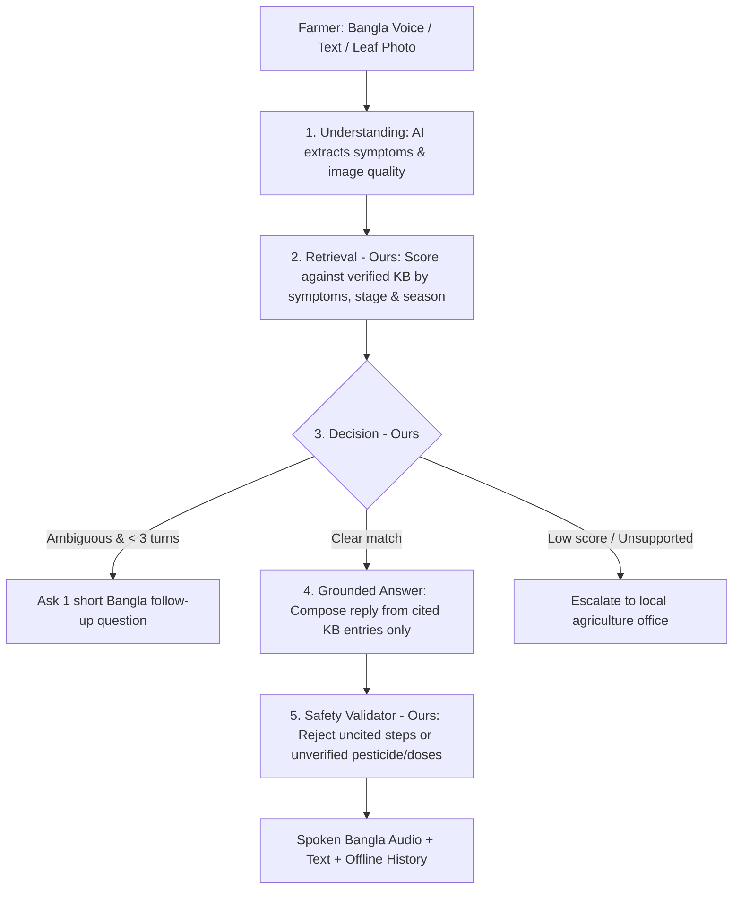

# KrishiSathi (কৃষিসাথী)

A Bangla, voice-first AI companion for smallholder farmers in Bangladesh. You speak what is wrong with your crop, it asks a few short follow-up questions, and it answers out loud in simple Bangla using verified agricultural guidance. We start with rice—the crop most farmers grow—while building the system so new crops can be added through verified content rather than rebuilding the app.

| | |
|---|---|
| **Track** | Agriculture — Aethermind 2026, BUCC, BRAC University |
| **Team** | Four undergraduate students from BRAC University |
| **UN SDG** | Target 2.4 (primary), Target 2.3 (secondary) |
| **First crop** | Rice (আউশ, আমন, বোরো) — starting point, not the boundary |
| **Status** | Round 1: static clickable prototype (`mockup/`). The Android app will be built during the Dec 11–20, 2026 build window. |
| **Live prototype** | Not published yet — the link goes here once the Round 1 mockup is deployed |
| **License** | MIT |

## Why we built it

Farming employs close to half of Bangladesh's workforce, and around 80% of farmers are smallholders (with UNDP reporting over 76% on small and marginal land — [source](https://www.undp.org/node/148791)). When a rice crop falls sick, expert help is often out of reach. A wrong guess can cost a season's harvest, and the common fallback is to spray more chemicals, raising costs and harming soil and water.

Most farming apps assume the user can type in search bars, read nested menus, and sign in with an email and password. In practice, many rural farmers are comfortable with visual, pattern-based apps like *imo*—they recognize big icons and repeat familiar steps once shown—but struggle with text-heavy navigation and account logins. KrishiSathi is designed to feel like asking a knowledgeable neighbour, with zero mandatory sign-in.

## What it does

- **Voice-first ask-back diagnosis:** Tap one large mic button and speak in Bangla (or send a leaf photo). Because a photo alone can mislead, the assistant asks up to 3 short follow-up questions (crop age, duration, standing water) before answering out loud in Bangla.
- **Grounded, safe advice:** Guidance comes strictly from verified Bangladeshi agricultural sources (BRRI, DAE, BARC, BAMIS). When confidence is low or a crop is not covered, KrishiSathi admits it and points the farmer to the local agriculture office instead of guessing.
- **Offline season companion:** Farmers can save their field profile (locally on the device, no login required), see their crop's growth stage and daily tasks, browse illustrated guides with audio, and keep a simple expense diary (*খরচের খাতা*)—all without an internet connection.

## How it works (beyond a thin AI wrapper)

The AI model handles Bangla speech/text and leaf-image understanding. Our own application logic controls retrieval, follow-up decisions, safety checks, and offline modules:



## Who it is for and how it pays for itself

Farmers use KrishiSathi **for free**. Organisations that already serve farmers—NGOs, cooperatives, agro-input companies, and mobile operators—fund access through a B2B2C sponsor model. Details and SDG target indicators are in [business and impact](docs/business-and-impact.md).

## What already exists

Several tools already serve Bangladeshi farmers, including Dr. Chashi, BRRI's *ধান সুরক্ষা*, Crops Doctor, GP Krishi Sheba, Krishi Desk, Digital Khamari, and KrishokBondhu. We compared each one and explained our differentiation in [market and competition](docs/market-and-competition.md).

## The goal behind it

KrishiSathi supports **UN Sustainable Development Goal 2**:
- **Target 2.4 (Primary):** Sustainable and resilient farming—reducing unnecessary chemical sprays through accurate, grounded triage.
- **Target 2.3 (Secondary):** Higher productivity and income for small-scale farmers—helping them act early and track seasonal costs.

## How to run the Round 1 prototype

The Round 1 prototype lives in `mockup/`. It is a static React + TypeScript app built with Vite, Material 3 web components, and a self-hosted copy of Hind Siliguri. All conversations, weather, and diagnoses in this prototype are scripted and clearly labeled **ডেমো**.

```bash
cd mockup
npm install
npm run dev       # opens the prototype at http://localhost:5173
```

To build the static files for deployment (Netlify, Vercel, or GitHub Pages):

```bash
cd mockup
npm run build     # type-checks and outputs static files to mockup/dist/
npm run preview   # previews the built output locally
```

Requires Node 20.19+ or 22.12+. The prototype is designed mobile-first (360–412 px width, shown inside a phone frame on desktop).

The Android app does not exist yet; it will be built fresh during the Dec 11–20 build window, with API keys stored in git-ignored `local.properties`.

## How AI is used

This is the full list of AI tools used on this project. Nothing is hidden from this table.

| Tool | What we used it for | Review |
|---|---|---|
| Claude (Anthropic) | Research, planning, drafting documents | Draft output is read and corrected by a team member before it is committed |
| ChatGPT (OpenAI) | Brainstorming, drafting documents | Draft output is read and corrected by a team member before it is committed |
| OpenCode with DeepSeek V4.1 Flash Free | Coding assistant: repository setup, writing and editing project documentation | Draft output is read and corrected by a team member before it is committed |
| Codebuff (Freebuff) | Coding assistant: building the Round 1 prototype, editing the README and preparing commits | Draft output is read and corrected by a team member before it is committed |

Speech recognition and text-to-speech models have not been chosen yet. Any voice model selected in Phase 2 will be listed here with its licence and cost.

No images or video have been made with AI. If we use any later, they will carry a visible label saying so.

## Open-source libraries

Everything the Round 1 prototype uses, with its licence:

| Library | Version | Licence | What it does here |
|---|---|---|---|
| [React](https://react.dev) and React DOM | 19.3 | MIT | Draws the screens and keeps their state |
| [Material 3 web components](https://md3.io) (`material`) | 3.16 | MIT | Buttons, cards, dialogs, navigation bar, progress bar and checkboxes |
| [Vite](https://vite.dev) | 7.3 | MIT | Development server and the production build |
| [TypeScript](https://www.typescriptlang.org) | 5.9 | Apache-2.0 | Type checking during the build; it is not shipped to the browser |
| [@vitejs/plugin-react](https://github.com/vitejs/vite-plugin-react) | 5.2 | MIT | Build-time support for React |
| [Hind Siliguri](https://fonts.google.com/specimen/Hind+Siliguri), Indian Type Foundry | 400, 600, 700 | SIL Open Font License 1.1 | The Bangla typeface, stored in `mockup/public/fonts/` together with its licence file |

Every library added to the Android app in Phase 2 will be listed here in the same way.

## Datasets

None yet. The photo test set for the build window will be our own photographs plus openly licensed images, and each source will be listed here.

## Knowledge base sources

Advice in the app comes only from public Bangladeshi agriculture guidance: the Bangladesh Rice Research Institute (BRRI), the Department of Agricultural Extension (DAE), the Bangladesh Agricultural Research Council (BARC), and BAMIS agro-advisories. Each entry records its exact page, publisher and access date, and is checked against the source by a team member before it is used. There is no entry without a source, and no advice in the app that isn't in an entry.

## Known limitations

- The Round 1 submission is a scripted prototype. It does not diagnose anything and does not use a real camera or microphone.
- The Android app will be built during the competition's 10-day window and is not yet released.
- It answers in Bangla only and starts with rice; for any crop without verified guidance, it states so and points to the local agriculture office.
- It is not a replacement for an agriculture officer.
- Bangla speech recognition and text-to-speech have not been tested widely yet; regional dialects are untested.
- There are no accuracy numbers yet. Any figures we publish later will come from our own described test set, including failures.
- The conversation needs internet. Only the guides, calendar, farm profile, diary and history work offline.

## License

MIT. See [LICENSE](LICENSE).
